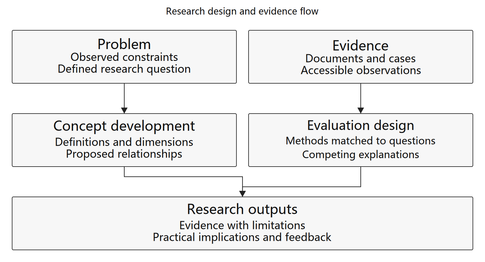

# Research Workflow Skills

Reusable agent skills for research figures, Zotero-linked Word manuscripts, and grant proposal design.

[中文说明](README.zh-CN.md)

These skills grew out of repeated manuscript revisions and Chinese research grant applications. They turn useful working habits into portable instructions and small tools. All examples are synthetic. Manuscripts, interviews, application forms, library exports, account identifiers, and local runtime bundles are excluded.

## Skills

| Skill | What it does | Included tools |
| --- | --- | --- |
| [`publication-chart-skill`](skills/publication-chart-skill/SKILL.md) | Research frameworks, mechanism diagrams, scientific plots, publication tables, faithful figure translation | Editable SVG generator with measured text fitting |
| [`zotero-docx-reference-workflow`](skills/zotero-docx-reference-workflow/SKILL.md) | Scholar-first discovery, DOI verification, Zotero ingestion, Word citation maintenance | DOCX field auditor; local Connector client |
| [`grant-proposal-workflow`](skills/grant-proposal-workflow/SKILL.md) | Align questions, substudies, methods, data, outputs, and figures with a grant template | Research-to-figure mapping template |

## Install

Clone this repository, then preview installation:

```sh
python tools/install_skills.py --dry-run
python tools/install_skills.py
```

The installer copies skills to `$CODEX_HOME/skills`, or `~/.codex/skills` when unset. Existing skill directories are skipped unless `--replace` is supplied; replacement first moves the old directory to a timestamped backup. For another agent, use `--dest /path/to/its/skills` if it supports `SKILL.md` folders. Reload the agent's skill list after installation.

Install just one skill:

```sh
python tools/install_skills.py --skill zotero-docx-reference-workflow
```

Example requests:

```text
Use $publication-chart-skill to make a compact grayscale mechanism diagram.
Use $zotero-docx-reference-workflow to audit this manuscript before refreshing Zotero.
Use $grant-proposal-workflow to map each substudy to its question, evidence and figure.
```

## Run The Tools

Python 3.10+ is required. DOCX auditing, Connector requests, and installation use the standard library. SVG generation needs Pillow; bitmap previews optionally need CairoSVG and its native Cairo runtime.

```sh
python -m pip install -r requirements-figures.txt
python skills/publication-chart-skill/scripts/make_framework.py skills/publication-chart-skill/examples/framework.json --out-dir build/framework
python skills/zotero-docx-reference-workflow/scripts/inspect_zotero_docx.py paper.docx --out-dir build/audit
python skills/zotero-docx-reference-workflow/scripts/zotero_connector.py ping
```

Pass `--font /path/to/font.ttf` to the SVG generator for predictable font measurement. A CJK font is needed for Chinese labels. `--png` adds a bitmap preview; inspect both the preview and the figure at its intended publication width.



The Connector client only contacts a loopback Zotero Desktop endpoint. `save` explicitly writes items to the library. It does not promise collection placement or infer item keys from an HTTP success response. Read back saved items through Zotero before citing them.

## What Is And Is Not Verified

The DOCX auditor reads actual Word field boundaries, including bibliography fields spanning paragraphs. It identifies hidden multi-item citations, malformed JSON, empty displays, duplicate citation IDs, missing document preferences, and inconsistent numbered citation displays. URI identity takes precedence over a citation's local numeric ID.

Offline field checks do not prove Zotero refresh works. Refresh verification requires Word/Zotero and inspection of the completed result. A macro returning without error is only evidence that the command was dispatched. See [Zotero troubleshooting](skills/zotero-docx-reference-workflow/references/troubleshooting.md).

`pubfig`, `pubtab`, Zotero, Word, browsers, and MCP servers are optional external tools, not included services. The skills discover what is available and report blockers. No credentials, proxy ports, library user IDs, or commercial Office templates are bundled.

## Development

```sh
python tools/validate_repo.py
python -m unittest discover -s tests -v
```

See [workflow design notes](docs/workflow-patterns.md) for the generalized project lessons and [scope and provenance](docs/scope-and-provenance.md) for the release inventory. MIT license applies to this repository's original instructions and code. External software retains its own license.
